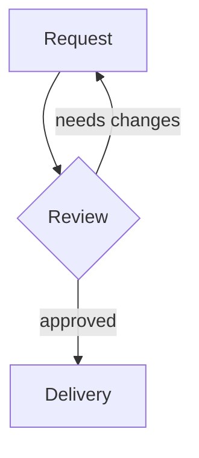

<!-- This maintainer note must not appear in the cleaned output. -->

# Engineering Handbook

This handbook describes how a team handles a request from intake to release.
Use the [request policy](/policies/request) when a request needs approval.

{}
We prefer written decisions, small changes, and clear ownership.
{}

## Request workflow

<div class="callout"><strong>Important:</strong> every request needs an owner.</div>

The workflow has three stages. The following table is part of the policy:

| Stage | Owner | Outcome |
| --- | --- | --- |
| Intake | Requester | A complete request |
| Review | Service owner | An approved decision |
| Delivery | Implementer | A traceable change |

## Decision flow



## Implementation notes

```python
def publish_change(change):
    return change.owner, change.approval
```

The implementation checklist keeps the process repeatable. A reviewer checks
the request, confirms the owner, records the decision, and links the final
change. This sentence is intentionally repeated to create a realistic long
text block that the chunker must split while preserving the section context.
The implementation checklist keeps the process repeatable. A reviewer checks
the request, confirms the owner, records the decision, and links the final
change. This sentence is intentionally repeated to create a realistic long
text block that the chunker must split while preserving the section context.
The implementation checklist keeps the process repeatable. A reviewer checks
the request, confirms the owner, records the decision, and links the final
change. This sentence is intentionally repeated to create a realistic long
text block that the chunker must split while preserving the section context.



The static guidance around dynamic content must remain searchable even when
the source system cannot provide the value.
